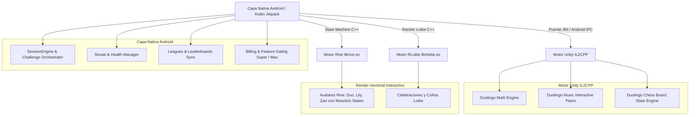
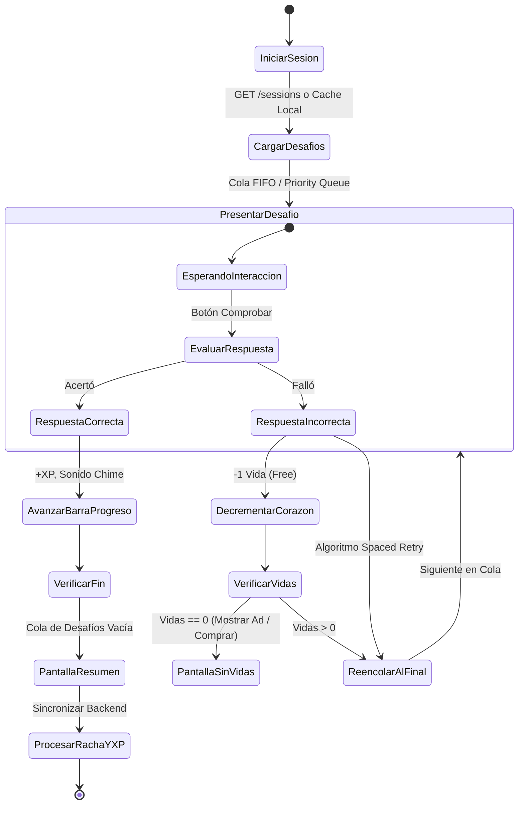
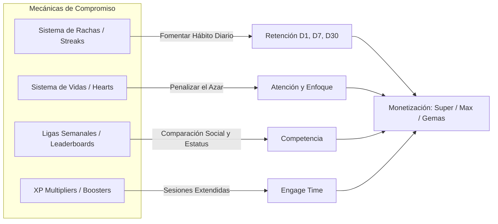
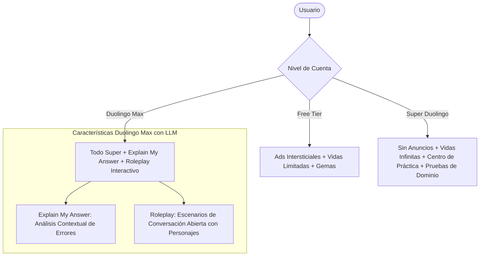

# 🦉 Arquitectura Interna, Algoritmos y Mecánicas de Duolingo (v6.103.6)

A partir del análisis forense y la descompilación del paquete APK distribuido (`com.duolingo`), sus **10 archivos Multidex (`classes.dex` a `classes10.dex`)** (90.950 clases, 531.045 métodos), los binarios nativos ARM64 (`libunity.so`, `libil2cpp.so`, `librive.so`, `librlottie.so`) y sus manifiestos y assets internos (`global-metadata.dat`, `modular_rive_*.json`, `hardcoded_sessions`), a continuación se desglosa la **lógica de negocio, algoritmos matemáticos, flujos de sesión y mecánicas de gamificación** que componen la plataforma.

---

## 1. Arquitectura Técnica de Alto Nivel y Stack Híbrido

Duolingo no es una aplicación monolítica tradicional ni un simple WebView; opera bajo una **arquitectura híbrida de 3 motores**:



### Componentes Clave del Stack:
1. **Host Nativo (Kotlin / Android Jetpack)**: Controla el árbol de pantallas (`DuoPathActivity`), persistencia local (Room SQLite + Datastore), autenticación, ciclo de suscripciones y el orquestador principal de lecciones de idiomas.
2. **Unity IL2CPP Engine (`libunity.so`, `libil2cpp.so`)**: Integrado dentro de `com.duolingo.app.unity.DuoUnityActivity`. Se activa dinámicamente cuando el usuario abre **Duolingo Math**, **Duolingo Music** o **Duolingo Chess**, delegando el canvas interactivo (teclado de piano táctil, tablero de ajedrez con motor Minimax/Stockfish embebido, o trazo vectorial de fracciones) a Unity.
3. **Motor Rive Vectorial (`librive.so`, `librive-android.so`)**: Maneja los personajes interactivos (Duo, Lily, Zari, Falstaff). En lugar de videos pre-renderizados o spritesheets pesados, usa **máquinas de estados vectoriales en tiempo real** (`modular_rive_lily.json`) con transiciones de ánimo (`idle`, `happy`, `bored`, `celebrate`, `eyeroll`) según el acierto o fallo del usuario.

---

## 2. El Motor de Sesión y Ciclo de Aprendizaje (`SessionEngine`)

Toda interacción de aprendizaje (lección, práctica de errores, cuento o examen de salto de nivel) es modelada por un grafo de estados orquestado por el modelo `Session`.



### Tipos de Desafíos (`Challenge Types`)
La cola de la lección (`challenges`) deserializa un arreglo polimórfico de clases derivadas de `com.duolingo.session.model.Challenge`:

| Challenge ID | Nombre Interno | Lógica de Interacción y Validación |
| :--- | :--- | :--- |
| `translate` | **TranslateChallenge** | Selección de fichas de palabras (token bank) o escritura en teclado libre. Valida contra un conjunto de `acceptedAnswers` y expresiones regulares de lematización. |
| `listen` / `listen_tap` | **ListenChallenge** | Reproducción de audio TTS (a velocidad normal 1.0x o lenta 0.5x). El usuario ensambla la transcripción auditiva. |
| `speak` | **SpeakChallenge** | Captura audio mediante AudioRecord, procesa fonemas y valida mediante HMM / Red Neuronal acústica en servidor o fallback de Android SpeechRecognizer. |
| `match` / `character_match`| **MatchChallenge** | Emparejamiento en cuadrícula 2xN de pares semánticos (palabra ↔ traducción o carácter ↔ pinyin/kana). |
| `name` / `select_transcription` | **SelectChallenge** | Opción múltiple con soporte de imágenes y pronunciación fonética. |
| `dialogue` / `read_comprehension` | **DialogueChallenge** | Mini-cuentos interactivos con preguntas intercaladas para medir retención contextual. |
| `math_match` / `chess_puzzle` | **UnityBridgeChallenge** | Interfaz transferida a la superficie Unity mediante eventos JNI. |

### La Mecánica de Retry (Re-encolado Inmediato):
Si el usuario falla un reto:
1. Se muestra el feedback correctivo con la solución resaltada.
2. El reto **no se descarta**: se reinserta en la cola con una distancia de amortiguación mínima (por defecto $d = \min(3, \text{elementos restantes})$), obligando al estudiante a responderlo de nuevo antes de poder completar la sesión con éxito.

---

## 3. Algoritmos Pedagógicos y Científicos

### A. Modelo de Repetición Espaciada: Half-Life Regression (HLR)
Duolingo no utiliza el clásico algoritmo SM-2 de SuperMemo/Anki; implementó su propio modelo publicado en investigación denominado **Half-Life Regression (HLR)**.

El objetivo es modelar la **vida media de la memoria** ($h$) de un lexema o concepto en la mente de un usuario a lo largo del tiempo.

#### 1. Ecuación de Retención y Olvido (Curva de Ebbinghaus):
La probabilidad $p$ de que el usuario recuerde correctamente una palabra tras un intervalo de tiempo transcurrido $\Delta t$ es:
$$p = 2^{-\frac{\Delta t}{h}}$$
Donde:
- $\Delta t$: Tiempo transcurrido desde el último repaso (en días o segundos).
- $h$: Vida media (half-life), es decir, el tiempo exacto en que la probabilidad de recuerdo cae al $50\%$.

#### 2. Estimación de la Vida Media ($h$):
La vida media $h$ no es fija; se recalcula tras cada práctica mediante una regresión lineal sobre un vector de características $\vec{x}$:
$$h = 2^{\vec{\theta} \cdot \vec{x}}$$
$$\log_2(h) = \theta_0 + \sum_{i=1}^{n} \theta_i x_i$$
El vector de características $\vec{x}$ incluye:
- $x_1$: Número de repeticiones previas correctas acumuladas ($n_{correct}$).
- $x_2$: Número de errores previos en esta palabra ($n_{incorrect}$).
- $x_3$: Dificultad intrínseca del lexema (calculada con base en los millones de respuestas de la comunidad).
- $x_4$: Tiempo medio de respuesta (latencia en milisegundos).

Cuando $p$ cae por debajo del **umbral de maestría objetivo** (típicamente $p < 0.75$), el servidor marca la habilidad como "agrietada" (*cracked skill*) y la prioriza en la lección diaria o sesión de repaso rápido.

---

### B. Algoritmo Adaptativo de Dificultad (Bandit / Item Response Theory)
Dentro de cada nodo del árbol (*Duo Path*), el sistema no envía preguntas idénticas a todos los usuarios:
1. **Perfil de Habilidad del Estudiante ($\theta$)**: Cada estudiante tiene un nivel latente estimado según la teoría de respuesta al ítem (IRT).
2. **Selección de Desafíos**: El motor evalúa dinámicamente si asignar opciones con "banco de palabras" (menor carga cognitiva) o "teclado libre" (mayor carga cognitiva) para maximizar el tiempo en la "Zona de Desarrollo Próximo" (mantener al usuario concentrado sin frustrarlo).

---

## 4. Gamificación Profunda: Mecánicas de Retención y Adicción Ética



### A. Sistema de Racha (*Streak Lifecycle*)
La racha es el núcleo de retención a largo plazo. Los campos serializados en el perfil del usuario incluyen:
- `streakDays`: Entero con la cantidad de días consecutivos con al menos una lección completada antes de la medianoche local.
- `streakFreeze`: Inventario de protectores de racha equipados (máximo 2 en cuentas gratuitas, automático/ilimitado en Super).
- `timezone`: La hora de corte se calcula con la zona horaria del dispositivo, pero sincronizada con timestamps UTC en el servidor (`streak_extended_today`).

#### Máquina de Estados de la Racha:
1. **Activa (Día $N$)**: El usuario completa una lección $\ge 10\text{ XP}$ antes de las 23:59 del día local.
2. **En Riesgo**: Llegan las 18:00 sin lección completada $\rightarrow$ Dispara notificaciones push de alta urgencia con tono de personaje ("Lily está decepcionada", "Duo está triste").
3. **Congelada (*Streak Freeze*)**: Si el día concluye sin actividad y `streakFreeze > 0`, se consume 1 protector de racha, la racha se preserva en $N$ y se notifica al usuario al día siguiente.
4. **Rota / En Recuperación (*Streak Repair*)**: Si no hay protector disponible, la racha cae a 0, pero se ofrece una ventana de 48 horas para comprar una **Reparación de Racha** (*Streak Repair*) con gemas o mediante una lección de rescate intensiva (*Streak Recovery Lesson*).

---

### B. Sistema de Vidas / Corazones (*Health System*)
Diseñado para desacelerar a los usuarios gratuitos y evitar que intenten adivinar sin prestar atención:
- **Capacidad Total**: 5 corazones (`health_total = 5`).
- **Penalización**: Cada respuesta incorrecta resta exactamente 1 corazón (`health_consumed = 1`).
- **Recarga por Tiempo**: 1 corazón cada 5 horas (recarga completa de 0 a 5 corazones en 25 horas).
- **Recarga Activa (*Practice to Earn Hearts*)**: El usuario puede acceder a una lección especial de repaso de conceptos aprendidos; completarla otorga 1 corazón sin costo alguno.
- **Bypass con Gemas**: Pagar entre 350 y 450 gemas para recargar al 100% al instante.
- **Modo Infinito**: Habilitado permanentemente en **Super Duolingo** y **Duolingo Max**.

---

### C. Ligas y Tablas de Clasificación (*Leaderboards*)
Un sistema de división deportiva estructurado en **10 ligas jerárquicas**:
1. Bronce
2. Plata
3. Oro
4. Zafiro
5. Rubí
6. Esmeralda
7. Amatista
8. Perla
9. Obsidiana
10. Diamante

#### Lógica de Agrupamiento y Competencia:
- **Buckets de 30 Usuarios**: El usuario no compite contra millones, sino en un grupo cerrado de 30 jugadores.
- **Asignación por Latencia**: Para evitar jugadores hiper-competitivos, el usuario es colocado en un grupo de 30 **en el momento exacto en que termina su primera lección de la semana** (después de las 00:00 UTC del lunes). Los que juegan inmediatamente son asignados con otros usuarios intensivos; los que juegan tarde, con usuarios casuales.
- **Zona de Ascenso**: Top 7-10 suben de división.
- **Zona de Descenso**: Los últimos 5 caen a la división inferior.
- **Torneo de Diamante**: Una mecánica final de 3 semanas (Cuartos, Semifinal, Final) para los miembros de la Liga Diamante.

---

### D. Economía de XP y Multiplicadores Estratégicos
El sistema de experiencia no es lineal; está optimizado con aceleradores de tiempo limitado:
- **Base XP**: 10 a 15 XP por lección regular + hasta 5 XP por bono de combo perfecto (*Combo Bonus*).
- **Poción de Doble XP (15 minutos)**: Duplica todas las ganancias de XP ($2\times$) durante 900 segundos.
- **Cofre del Madrugador (*Early Bird Boost*)**: Si completas una lección entre las 06:00 y las 12:00, desbloqueas un $2\times$ XP que se activa únicamente en la noche (18:00 a 23:00).
- **Cofre Noctámbulo (*Night Owl Boost*)**: Si completas una lección entre las 18:00 y las 23:59, desbloqueas un $2\times$ XP para la mañana siguiente.
- **Efecto de Retención**: Esta pareja de boosters incentiva al usuario a abrir la app **mínimo dos veces al día** en franjas horarias opuestas.

---

## 5. Lógica de Negocio, Monetización y Duolingo Max

Duolingo monetiza a través de un modelo freemium de tres niveles gestionado por el módulo `Billing`:



### Funciones Exclusivas de Duolingo Max (Descompiladas en Kotlin/DEX):
1. **Explain My Answer (`com.duolingo.session.explain_my_answer`)**:
   - Tras equivocarse en una pregunta, el usuario pulsa un botón interactivo.
   - La app envía al backend el ID de la pregunta, la respuesta dada por el usuario, la respuesta esperada y el historial de errores recientes.
   - El modelo (GPT-4) genera una explicación pedagógica personalizada en tono conversacional simulando la voz del personaje Duo.
2. **Roleplay (`PracticeHubRoleplayScenariosFragment`)**:
   - Escenarios de rol (ejemplo: pedir un café en París, negociar un precio en Tokio).
   - Generación de respuestas dinámicas con corrección sintáctica al vuelo y sugerencias contextuales de vocabulario.

---

## 6. Multi-Dominio Curricular: Idiomas, Matemáticas, Música y Ajedrez

En versiones recientes, Duolingo consolidó todas sus aplicaciones independientes dentro del mismo binario unificado:

| Dominio | Motor de Render | Mecánica Específica |
| :--- | :--- | :--- |
| **Idiomas** | Nativo + Rive | Token selector, fonemas de reconocimiento de voz, árboles de gramática CEFR (A1 a C1). |
| **Duolingo Math** | Unity (`libunity.so`) | Trazado interactivo de fracciones, ángulos con transportador virtual, multiplicación mediante matrices visuales. |
| **Duolingo Music** | Unity (`libunity.so`) | Lectura de partituras en tiempo real con pentagrama en movimiento y teclado de piano táctil de 8 a 13 teclas con latencia baja. |
| **Duolingo Chess** | Unity (`libunity.so`) | Puzzles tácticos de ajedrez, jugadas forzadas y partidas de evaluación contra bots con personalidades (Oscar, Lily, Duo). |

---

## 7. Modelos de Datos Internos (JSON Schemas Replicables)

Para replicar esta arquitectura en otro juego o aplicación educativa, los dos esquemas esenciales de datos son:

### Esquema de una Lección (`Session` JSON)
```json
{
  "id": "sess_fr_unit1_lesson3",
  "type": "REGULAR",
  "trackingProperties": {
    "course_id": "fr_es",
    "unit_index": 1,
    "level_index": 3
  },
  "heartsEnabled": true,
  "challenges": [
    {
      "id": "chal_trans_001",
      "type": "translate",
      "prompt": "Bonjour, comment ça va ?",
      "sourceLanguage": "fr",
      "targetLanguage": "es",
      "tokens": ["Hola", ",", "¿cómo", "estás", "adiós", "bien", "?"],
      "acceptedAnswers": [
        "Hola, ¿cómo estás?",
        "Hola, ¿cómo va?"
      ],
      "characterId": "lily",
      "characterAnimation": "bored"
    },
    {
      "id": "chal_listen_002",
      "type": "listen",
      "audioUrl": "https://tts.duolingo.com/voice_duo_slow_001.mp3",
      "acceptedAnswers": ["Je suis un chat"],
      "tokens": ["Je", "suis", "un", "chat", "chien", "mange"]
    }
  ],
  "rewards": {
    "baseXp": 15,
    "gemReward": 5,
    "questEligible": true
  }
}
```

### Esquema del Estado del Jugador (`UserGameProgress` JSON)
```json
{
  "userId": "usr_998124a",
  "streak": {
    "count": 42,
    "extendedToday": true,
    "freezesEquipped": 2,
    "lastCompletedDate": "2026-10-27"
  },
  "health": {
    "currentHearts": 4,
    "maxHearts": 5,
    "nextRefillTimestamp": 1793234500
  },
  "league": {
    "currentTier": "OBSIDIAN",
    "bucketId": "obsidian_group_902",
    "weeklyXp": 1420,
    "rank": 4
  },
  "inventory": {
    "gems": 2450,
    "lingots": 0,
    "activeBoosters": [
      {
        "type": "DOUBLE_XP",
        "expiresAt": 1793215800
      }
    ]
  }
}
```

---

## 8. Conclusiones y Claves de Diseño para Replicar

1. **Desacoplar Contenido de Lógica**: La aplicación es esencialmente un intérprete de JSON. Todo el árbol curricular, retos y respuestas son descargados dinámicamente y evaluados localmente por la máquina de estados.
2. **Cerrar el Bucle de Retención**: La combinación de **Streaks + Protectores + Early Bird / Night Owl Boosters** crea dos ventanas de enganche diario (mañana y noche), garantizando tasas de retención D7 y D30 líderes en la industria móvil.
3. **Optimización con Rive**: El uso de animación vectorial en tiempo real (`librive.so`) permite personajes con personalidad viva y reactiva sin sobrecargar el consumo de memoria ni el tamaño del APK.
