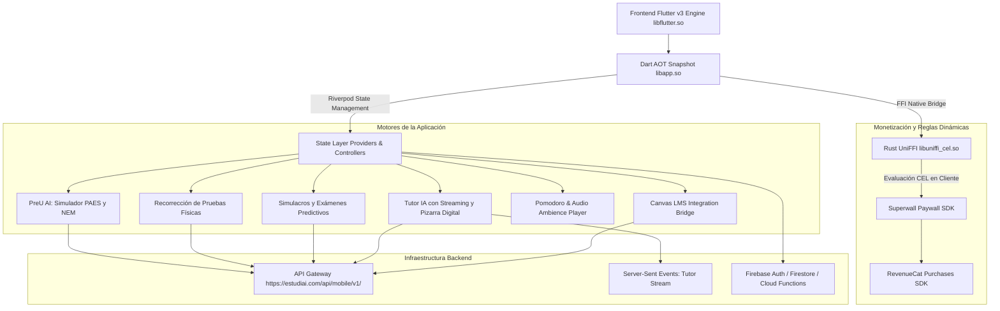
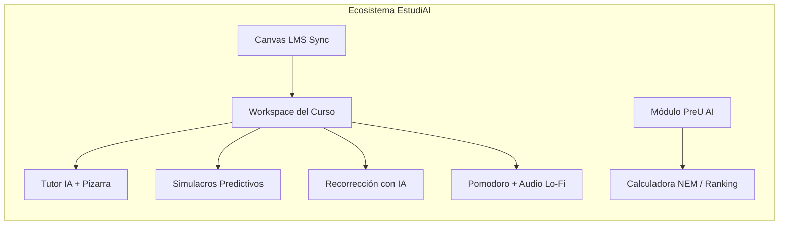
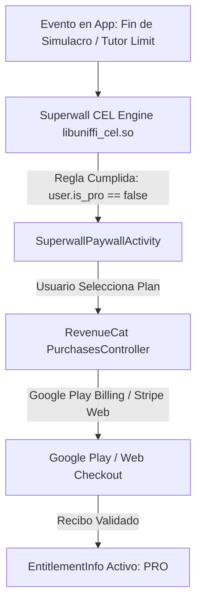

# 🎓 Arquitectura Interna, Algoritmos y Mecánicas de EstudiAI (v1.0.8 / Build 12)

A partir del análisis forense y la descompilación del paquete distribuido (`com.estudiai.estudiai_app-12_arm64-v8a.xapk`), sus binarios AOT de 64 bits (`libapp.so`, `libflutter.so`, `libuniffi_cel.so`), sus 4 archivos DEX (21.528 clases, 131.462 métodos), sus assets de fórmulas LaTeX y su manifiesto decodificado (`AndroidManifest_decoded.xml`), se presenta la **arquitectura técnica, flujos de usuario, algoritmos pedagógicos, modelos de negocio y lógica de backend** que componen la plataforma.

---

## 1. Arquitectura Técnica de Alto Nivel y Stack Tecnológico

EstudiAI es una plataforma EdTech híbrida orientada a estudiantes universitarios de ingeniería/ciencias (STEM) y postulantes a la educación superior (Preuniversitario / PAES).



### Componentes de Infraestructura:
1. **Frontend Flutter AOT (`libapp.so`, 23.1 MB)**: Contiene 979 archivos Dart compilados a código de máquina ARM64, estructurado bajo el patrón **Repository / Service / Provider (Riverpod)**.
2. **Motor de Reglas Rust CEL (`libuniffi_cel.so`, 2.07 MB)**: Implementa el evaluador de *Common Expression Language (CEL)* de Mozilla UniFFI. Permite a la aplicación evaluar localmente en el dispositivo si se debe mostrar un paywall según atributos del usuario (días de uso, intentos de examen consumidos) sin latencia de red.
3. **Seguridad y Anti-Tamper (`PairIP LicenseCheck`)**: Protegido mediante `com.pairip.application.Application` y verificación de integridad contra copias no autorizadas en Google Play.
4. **Renderizado Matemático Vectorial**: Integración de `flutter_math_fork` para compilar e interpretar fórmulas tipográficas LaTeX complejas en tiempo real.

---

## 2. Los 6 Módulos Principales y su Funcionamiento Interno



---

### Módulo I: Integración con Canvas LMS Universitario
A diferencia de aplicaciones cerradas, EstudiAI se conecta directamente al campus virtual universitario del estudiante (por ejemplo, `canvas.tuuniversidad.cl`):
- **Flujo de Conexión (`CanvasConnectScreen`)**:
  1. El estudiante ingresa la URL de Canvas de su casa de estudios.
  2. La app instruye al usuario para generar un **Personal Access Token** en la sección oficial de Canvas (*"Tokens de acceso aprobados"*).
  3. El cliente almacena el token de forma segura (`CanvasConnectionInfo`) y consulta `/api/canvas-courses/`.
- **Mapeo Curricular Inteligente (`CanvasCourseMapping`)**:
  - Mapea las asignaturas oficiales del semestre a los planes de estudio de la plataforma.
  - Extrae archivos PDF, presentaciones y apuntes subidos por los profesores universitarios (`listCanvasFiles`) para alimentar el contexto del tutor y los exámenes.
  - Sincroniza calendarios y fechas de certámenes (`calendar_exam_store.dart`).

---

### Módulo II: Tutor IA con Razonamiento y Pizarra Interactiva
El tutor no es un simple chatbot de texto; es un entorno pedagógico multimodal interactivo:
- **Endpoints de Streaming SSE**:
  - `/api/mobile/v1/tutor/stream`
  - `/api/mobile/v1/notebook/tutor/stream`
  - `/api/mobile/v1/guiado/tutor/stream`
- **Estado de Razonamiento en Vivo (`get:tutorThinking`)**:
  - Muestra un estado visual ("El tutor está pensando...") mientras los modelos de lenguaje de razonamiento (como Claude 3.5 Sonnet u o1) construyen el árbol de deducción matemática.
- **Pizarra Digital Táctil (`PizarraCanvasOverlay`)**:
  - Permite al estudiante y al tutor dibujar a mano alzada sobre la pantalla.
  - Componentes: `_PizarraPainter`, `_PizarraStroke`, selector de grosor (`tutorPizarraStrokeWidthSlider`), colores (`tutorPizarraColor_`), deshacer (`tutorPizarraUndoButton`) y guardado de pizarra como evidencia de estudio.
- **Renderizado de Fórmulas en Vivo**:
  - El flujo de texto con etiquetas `$$ ... $$` o `\( ... \)` es interceptado por `CanvasMarkdownBlock` y renderizado mediante matrices afines (`AffineMatrix`) con `flutter_math_fork`.

---

### Módulo III: Simulacros y Exámenes Predictivos
Módulo diseñado para eliminar la incertidumbre antes de un certamen universitario o prueba de admisión:
- **Flujo del Simulacro**:
  1. **Generación (`/api/mobile/v1/simulacro/generate`)**: La IA analiza el temario del curso y los documentos de Canvas (`/analyze-from-course`) para predecir qué preguntas tienen mayor probabilidad de entrar en la evaluación real.
  2. **Sesión Activa (`SimulacroActiveScreen`)**: Pantalla en modo examen con cuenta regresiva estricta, registro de respuestas (`SimulacroAnswer`), omisiones y bloqueo de distracciones.
  3. **Evaluación y Brechas (`SimulacroResultScreen`)**:
     - Desglose: Correctas, Incorrectas, Parciales y Omitidas.
     - **Análisis de Brechas (`study-gaps`)**: Identifica temas específicos donde el alumno falló (ej. *"Técnicas de Integración por Partes"*).
     - **Exportación PDF (`simulacro_pdf_service.dart`)**: Genera un archivo PDF con formato oficial universitario para imprimir o archivar.

---

### Módulo IV: Recorrección de Exámenes Reales (`Recorrección`)
Una de las mecánicas más innovadoras del código descompilado:
- **El Problema**: Los estudiantes reprueban pruebas universitarias y muchas veces la corrección del profesor es ilegible o no explica el error conceptual.
- **El Flujo**:
  1. El estudiante sube fotografías o el PDF de su examen calificado a `/api/mobile/v1/recorreccion/uploads`.
  2. El pipeline de visión por computadora y LLM digitaliza las preguntas y el desarrollo manuscrito del alumno (`DigitalizedExerciseSimulacro`).
  3. La IA compara la solución del estudiante contra la pauta de corrección oficial paso a paso.
  4. **Generación Remedial (`practice-similar`)**: Tras señalar el error exacto, el sistema genera inmediatamente 3 ejercicios equivalentes para asegurar que el concepto haya sido asimilado.

---

### Módulo V: Sala de Estudio Pomodoro y Audio Ambiental
Diseñado para inducir estados de hiperfoco (*deep work*) dentro de la aplicación:
- **Presets de Pomodoro (`notebook.focus.pomodoro_preset`)**:
  - `notebookPomodoro255`: 25 minutos de estudio + 5 minutos de pausa.
  - `notebookPomodoro5010`: 50 minutos de estudio intensivo + 10 minutos de descanso.
  - Transiciones de estado gestionadas por `_switchPomodoroPhase` y `_tickPomodoro`.
- **Reproductor de Audio Ambiental (`AudioAmbiencePlayer`)**:
  - Mezcla pistas de audio lo-fi y lluvia en bucle (alojadas en Pixabay CDN) en segundo plano mientras el estudiante lee o resuelve problemas.
  - Pausa y reanudación automática sincronizada con los ciclos del temporizador Pomodoro (`StudySessionAmbienceBridge`).

---

### Módulo VI: PreU AI (Simulador PAES, NEM y Admisión Universitaria)
Específicamente adaptado al sistema de admisión universitaria chileno (DEMRE / Consejo de Rectores):
- **Calculadora NEM y Ranking (`paes_nem_calculator.dart`)**:
  - Convierte las notas de enseñanza media (escala chilena 1.0 a 7.0) a la escala estándar PAES (100 a 1.000 puntos).
  - Algoritmo de interpolación lineal según tablas de conversión oficiales DEMRE:
    $$\text{Puntaje NEM} = \text{Interpolar}(NEM, \text{TablaDEMRE})$$
- **Simulador de Postulación (`SimuladorPostulacionScreen`)**:
  - El usuario ingresa sus puntajes proyectados (`PostulationScores`: NEM, Ranking, M1, M2, Lectora, Ciencias/Historia).
  - La aplicación consulta `/api/catalog/degrees` y calcula el **Puntaje Ponderado Final** para cada carrera universitaria:
    $$\text{Puntaje Ponderado} = \sum_{i} (\text{Puntaje}_i \times \text{Ponderación}_i)$$
  - Compara el resultado con los puntajes de corte del último año y clasifica la probabilidad de ingreso en categorías de viabilidad.
- **Buscador de Becas (`PreuAiBecaListResponse`)**:
  - Filtra becas estatales (Gratuidad, Bicentenario, Excelencia Académica) compatibles con el perfil del estudiante.

---

## 3. Retención y Gamificación: Sistema de Racha (`Streak Engine`)

EstudiAI adoptó la mecánica de retención diaria de Duolingo adaptada a la disciplina de estudio:
- **Estructura del Modelo (`PreuAiStreak` / `UserStreak`)**:
  - `currentStreak`: Número de días seguidos con al menos 1 sesión de estudio o mini-quiz resuelto.
  - `streakDays`: Historial de actividad persistido en almacenamiento local.
- **Componentes Visuales**:
  - `StreakTimeline` (`package:estudiai_app/widgets/preuai/streak_timeline.dart`): Indicador de los 7 días de la semana con la llama de fuego (`home-profile-streak-flame`).
  - `StreakCelebrationOverlay`: Animación modal de celebración cuando el alumno alcanza hitos clave (3, 7, 14, 30 días de racha).
  - Consulta periódica al endpoint `/api/streak` para sincronizar con el backend.

---

## 4. Currículo STEM Integrado (729 Lecciones Internas)

El código AOT almacena catálogos completos de cursos universitarios y lecciones interactivas (`*_interactivo.dart`):

| Asignatura | Lecciones Identificadas | Temas Clave Identificados en Código |
| :--- | :---: | :--- |
| **Álgebra Lineal** | 74 | Matrices, transformaciones lineales, cálculo de inversas, valores propios y vectores propios. |
| **Química General** | 80 | Estequiometría, equilibrio químico, termoquímica, enlaces moleculares. |
| **Introducción a la Programación** | 68 | Variables locales vs globales, algoritmos de ordenamiento, recursión y estructuras de datos. |
| **Física General** | 60 | Momento de inercia, conservación de energía, sistemas aislados, electromagnetismo. |
| **Optimización** | 60 | Método Simplex, dualidad, precios sombra, programación dinámica (Principio de Bellman). |
| **Cálculo I** | 58 | Definición formal $\varepsilon$-$\delta$, leyes de límites, reglas de derivación, optimización. |
| **Precálculo** | 52 | Factorización, funciones polinomiales, trigonometría, desigualdades. |
| **Cálculo II** | 48 | Técnicas de integración por partes, fracciones parciales, integrales impropias Tipo I. |
| **Probabilidad y Estadística** | 41 | Eventos independientes, Teorema de Bayes, distribuciones continuas y discretas. |
| **Ecuaciones Diferenciales** | 40 | Problemas de Valor Inicial (PVI), transformadas de Laplace, Teorema de Existencia y Unicidad (TEU). |
| **Cálculo Vectorial** | 34 | Gradiente, derivadas direccionales, integrales de línea, campos conservativos. |

Además, los archivos `assets/formulas/*.json` (`calculo-1.json`, `algebra-lineal.json`, etc.) sirven como **formulario offline indexado** con categorización semántica, etiquetas y fórmulas en código LaTeX listo para visualizar.

---

## 5. Monetización y Lógica de Negocio

La infraestructura de cobro combina dos de los frameworks más modernos del ecosistema móvil:



### Características del Modelo de Negocio:
1. **Superwall SDK (`superwallkit_flutter`)**:
   - Permite al equipo de marketing actualizar el diseño del paywall de forma remota sin subir una nueva versión del APK.
   - Las reglas de segmentación se evalúan en microsegundos en el dispositivo gracias a `libuniffi_cel.so`.
2. **RevenueCat (`purchases_flutter`)**:
   - Maneja la validación de suscripciones in-app (`StoreProduct`, `SubscriptionOption`, `PricingPhase`).
   - Soporta sincronización de compras web (`web_subscription_service.dart`) para usuarios que se suscribieron desde la página web mediante tarjeta de crédito o transferencia bancaria chilena.
3. **Planes y Entitlements**:
   - Ofrece periodo de prueba gratuito (`FREE_TRIAL`).
   - El estado "PRO" desbloquea simulacros predictivos ilimitados, recorrección fotográfica de certámenes y acceso continuo al tutor sin límite de tokens.

---

## 6. Esquemas de Datos Internos (JSON)

### A. Esquema de Pregunta de Simulacro (`SimulacroQuestion`)
```json
{
  "id": "sim_calc1_042",
  "cursoId": "calculo-1",
  "categoria": "Técnicas de Integración",
  "dificultad": "ALTA",
  "enunciado": "Calcule la integral indefinida \\int x^2 e^{2x} \\, dx utilizando integración por partes.",
  "opciones": [
    { "id": "A", "latex": "\\frac{1}{2} e^{2x} (x^2 - x + \\frac{1}{2}) + C", "esCorrecta": true },
    { "id": "B", "latex": "e^{2x} (x^2 - 2x + 2) + C", "esCorrecta": false },
    { "id": "C", "latex": "\\frac{1}{4} e^{2x} (2x^2 - 2x + 1) + C", "esCorrecta": false }
  ],
  "explicacionPasoAPaso": "Se aplica integración por partes dos veces con u = x^2 y dv = e^{2x} dx...",
  "tiempoRecomendadoSegundos": 180
}
```

### B. Esquema de Ponderación de Carrera Universitaria (`PreuAiCareerWeightings`)
```json
{
  "carreraId": "ing-civil-plan-comun-uchile",
  "universidad": "Universidad de Chile",
  "nombreCarrera": "Ingeniería Civil Plan Común",
  "nem": 0.10,
  "ranking": 0.20,
  "competenciaLectora": 0.10,
  "competenciaMatematica1": 0.25,
  "competenciaMatematica2": 0.20,
  "ciencias": 0.15,
  "historia": 0.00,
  "puntajeCorteUltimoSeleccionado": 842.50
}
```

---

## 7. Comparativa Arquitectónica: Duolingo vs. EstudiAI

| Dimensión | Duolingo (v6.103.6) | EstudiAI (v1.0.8) |
| :--- | :--- | :--- |
| **Framework Primario** | Nativo Android (Kotlin Jetpack) Multidex (10 DEX) | Flutter v3 (Dart AOT compilado en `libapp.so`) (4 DEX) |
| **Motores Secundarios** | Unity IL2CPP (Math/Music/Chess) + Rive C++ Vector | Rust UniFFI (`libuniffi_cel.so`) + Flutter Math LaTeX |
| **Algoritmo Pedagógico** | Half-Life Regression (HLR) para retención mnemotécnica | Andamiaje socrático asistido por LLM + Detección de brechas (*Study Gaps*) |
| **Mecánica Central** | Micro-lecciones gamificadas con Vidas/Corazones | Simulacros predictivos + Recorrección de exámenes + Tutor con Pizarra |
| **Integración Externa** | Ninguna (Ecosistema cerrado con avatares propios) | **Canvas LMS** universitario mediante API de Tokens de Acceso |
| **Sistema de Racha** | Racha con Protectores (`Streak Freeze`) y Multiplicadores XP | Racha de estudio diario con línea de tiempo semanal y celebraciones |
| **Herramienta de Concentración** | Lecciones rápidas de 3 minutos | Temporizador Pomodoro (25/5 y 50/10) con música Lo-Fi ambiental |
| **Monetización** | AdMob + Super Duolingo + Duolingo Max (GPT-4) | Superwall (CEL dinámico) + RevenueCat (In-App y Web Paywall) |
